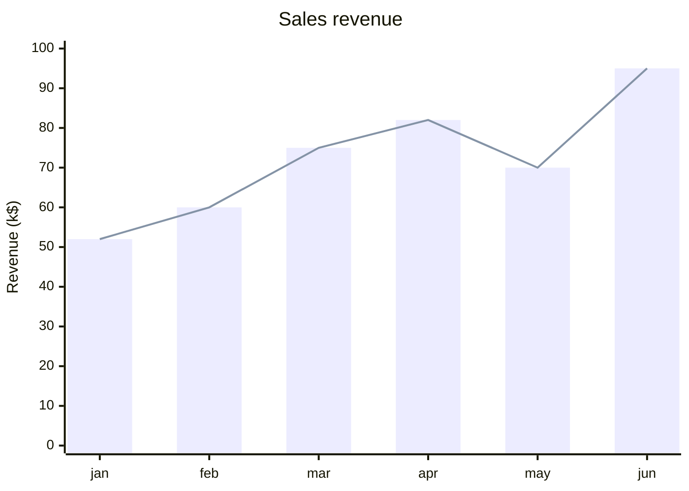
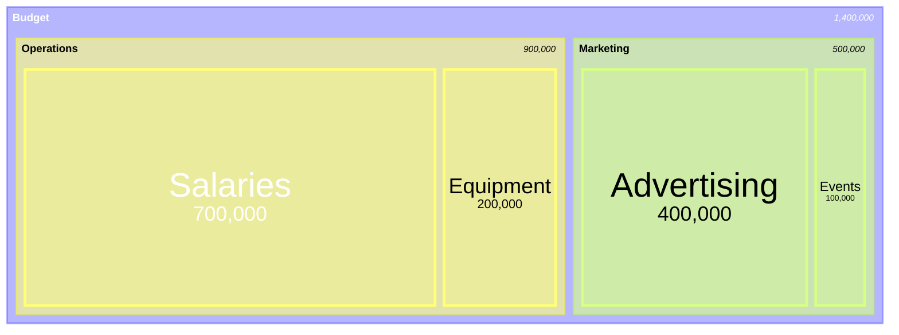
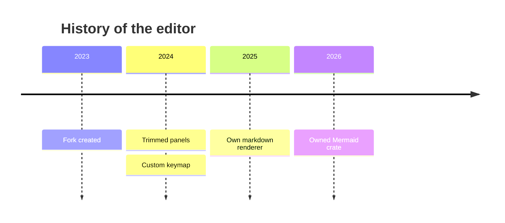
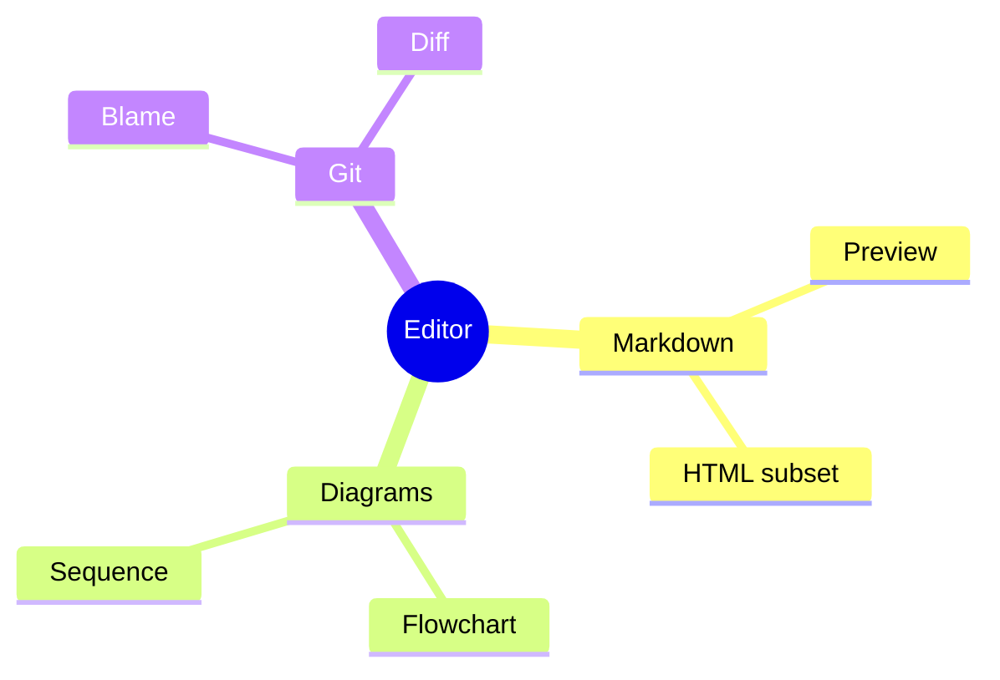

# Mermaid: charts and hierarchies

Check each renders, labels don't overlap badly, and colors follow the theme.

## Railroad

```mermaid
railroad-beta
title Expression grammar

expression = sequence(
    nonterminal("term"),
    zeroOrMore(sequence(
        choice(terminal("+"), terminal("-")),
        nonterminal("term")
    ))
) ;
term = oneOrMore(nonterminal("digit")) ;
```

## XY chart



## Treemap



## Timeline



## Mindmap


